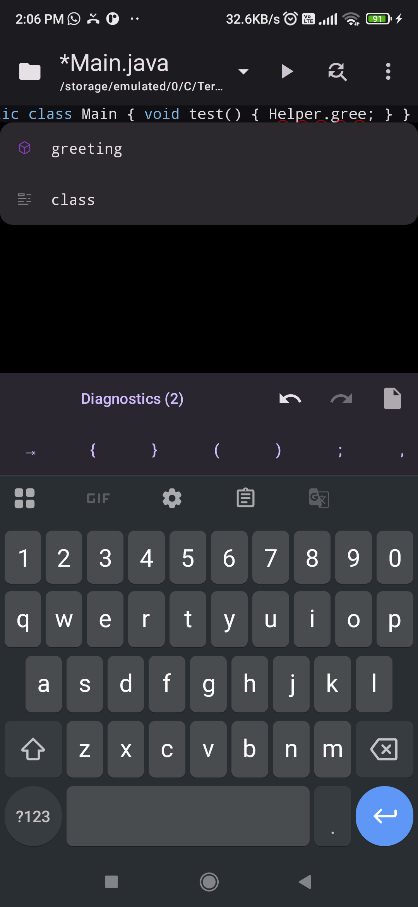
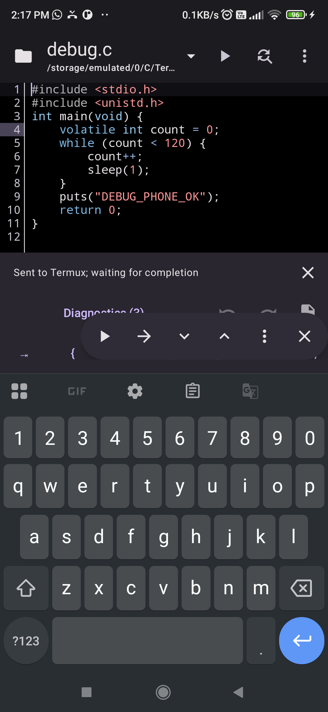
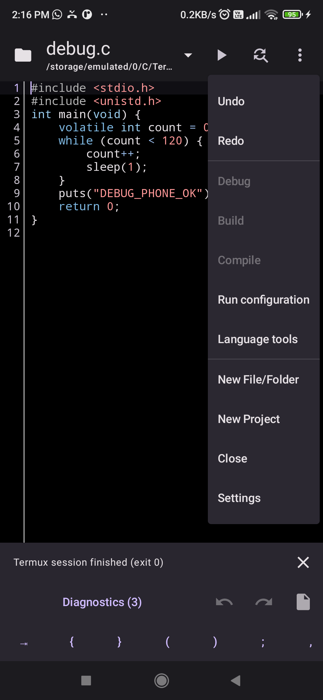

  

<strong>One IDE for Android. Powered by Termux.</strong>

# TermuIDE

[Download](https://github.com/AM-RTS/TermuIDE/releases) · [User guide](docs/usage.md) · [Build instructions](docs/building.md) · [中文](README_zh.md)

TermuIDE is an Android IDE for C/C++, with basic Python and Java console support. It combines a Material 3 interface, the Sora editor, language-server completion, and recovery of unsaved work. Compilers and language tools run in Termux and are installed separately.

An independent fork of [TermuC](https://github.com/RainbowC0/TermuC), maintained by AM-RTS and contributors. It is not an official TermuC or Termux release.

## Screenshots

<table>
  <tr>
    <td align="center"> Java completion</td>
    <td align="center"> C/C++ debugging</td>
    <td align="center"> Editor tools</td>
  </tr>
</table>

Captured on a physical Android device on October 30, 2026.

## What is different in this fork

Added or changed in TermuIDE:

- **Material 3 Compose UI:** adaptive file browser, accessible controls, and restored dialog input.
- **Sora editor:** modern rendering and input, retaining the original document, undo and lexer utilities.
- **Unsaved-work recovery:** durable drafts, background saves, and optional auto-save.
- **Python and Java:** console execution, Python pylsp integration, and optional Java completion/diagnostics.
- **Workspace controls:** open-file picker with close prompts, an on-demand diagnostics sheet, and bottom Undo/Redo/Save actions.
- **Run configurations and debugging:** entry file, arguments and working directory settings; updated GDB controls and inspection panels.

## Language support

| Capability | C/C++ | Python | Java |
| --- | --- | --- | --- |
| Run | Clang / configured project commands | Python 3 scripts | Single-file console programs, JDK 11+ |
| Completion and diagnostics | clangd | pylsp; diagnostics depend on plugins | Optional TermuIDE Java server, JDK 25 |
| Navigation and editing tools | Definitions, rename, formatting, code actions | Server/plugin dependent | Completion and diagnostics only |
| Debugging | GDB | Not supported | Not supported |

Python/Java dependency management, Maven/Gradle project import, and Android APK development are not supported. Java analysis currently uses JDK 25 APIs; target-release and dependency-classpath settings are not exposed.

## Get started

Requires **Android 8.1+ (API 27)** and Termux with RUN_COMMAND result support (0.109+).

1. Install an APK from [TermuIDE releases](https://github.com/AM-RTS/TermuIDE/releases) and install [Termux](https://github.com/termux/termux-app#installation).
2. Grant storage and Termux command access. Enable external-app access in Termux; allow overlay permission if using GDB floating controls. See the [setup guide](docs/usage.md#termux-access).
3. Open **⋮ → Language tools → Install / Repair** for the language you need. Setup opens Termux for confirmation. Java setup requires a matching published tools archive; [manual setup](docs/usage.md#java) is also available.
4. Select **Settings → Analysis → Completion → Language Server** for language-server features. Open a source file and press **Run**.

Projects use **`termuide.json`**. Existing project commands remain authoritative; selecting a Python or Java tab does not replace them. See [projects and run configurations](docs/usage.md#projects-and-run-configurations).

## Saving and recovery

Unsaved edits are checkpointed privately and restored after restarting the app, without overwriting source files. Dirty tabs offer **Save / Discard / Cancel** when closed. Optional **Settings → Editor → Auto-save** saves after a one-second typing pause; it is off by default.

Recovery is not a backup: termination before a checkpoint can lose the latest keystrokes, and uninstalling or clearing app data removes private drafts. TermuIDE (`amrts.termuide`) installs separately from upstream TermuC; save/export old unsaved work before removing the old app. Settings, permissions and drafts are not imported automatically.

## Automated prereleases

Pushes to `master` run regression checks and, on success, publish a signed prerelease with an APK, checksums, optional Java tools and change notes. See [build and signing instructions](docs/building.md). Architecture and verification records are in the [runtime notes](docs/architecture/multilanguage-runtime.md).

## Acknowledgements and license

TermuIDE builds on **TermuC** by RainbowC0 and contributors, **CodeEditor** by MrIkso and contributors, **TextWarrior** by Tah Wei Hoon and contributors, and **Sora** by Rosemoe and contributors. Thanks also to the AndroidX, Compose Material 3, Kotlin, Termux, and Java language-server communities.

The app retains [GNU GPL v3](LICENSE.md). Sora uses LGPL 2.1 or later; attributed TextWarrior files and AndroidX/Kotlin use Apache 2.0. Component notices and source links are in [NOTICE.md](NOTICE.md); full licenses are available offline in **Settings → About → About TermuIDE**. Redistribution must retain notices and provide corresponding source and build instructions for the exact release. There is no warranty; see the licenses.
