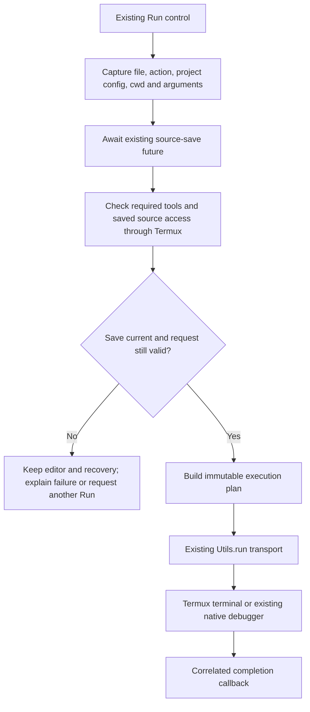

# Multi-language runtime architecture

Status: TermuIDE (`amrts.termuide`); shared runtime foundation, basic Python/Java execution, generalized LSP sessions and Python pylsp integration implemented; Java server selection and advanced integrations remain planned. Updated 2026-10-26.

## Shared language-server foundation

`LanguageServers` owns lazy sessions keyed by server and normalized project/folder root. C/C++ share clangd; Python uses pylsp; Java is deliberately unconfigured. Every session keeps its own socket port, initialize capabilities, request IDs and open-document set. The configured port is the starting port; allocation avoids immediately reusing a bridge still shutting down. The existing Termux `nc` stdio bridge launches both tools with literal argument arrays. No app dependency, additional module or recovery-format change is needed.

The existing `MainHandler` remains the Activity/save bridge and parses messages carrying their source LSP and generation. Replies, diagnostics, semantic tokens, commands and completion selections use that identity. Shutdown invalidates queued events and displayed completions. Unsupported capabilities are not requested; only clangd receives fallback compiler flags. `Languages.canDebug()` separately restricts GDB to native languages.

`didOpen` uses the language registry and current document version, and sends the actual editor buffer, including recovered unsaved text. Opening the same document twice in one session is suppressed. Subsequent changes retain version/revision guards. Settings changes and project transitions restart sessions; closing the last associated tab stops its server. Opening another supported tab retries an unexpectedly disconnected server on a fresh port, rebinds its existing documents and reopens their current buffers after initialization; unrelated language sessions continue running. A disconnected server never changes draft/source ownership. Installation/retry instructions are in the README; interpreter/virtual-environment configuration and Java integration are deferred.

CI regression coverage includes session isolation, port allocation, capabilities, stale responses, recovery-preserving Python completion and C/C++ debugger gating. The signed prerelease workflow installs `python-lsp-server==1.15.0` in a temporary virtual environment and enables a host integration check using the actual app LSP client against real pylsp, including a sibling import from an unsaved recovered buffer. Local Gradle/build/test execution, phone and emulator checks remain skipped. CI reports distinguish host verification from device behavior; previous physical-device evidence below predates this implementation. The initial CI run also exposed programmatic paste arriving before Sora line measurements completed; that path now reuses `EditorTextEdits` and the existing safe full-buffer refresh while layout is busy, retaining undo and dirty/recovery tracking.

Review hardening (2026-10-26): LSP framing now validates bounded headers and UTF-8 byte lengths before allocating reply buffers. Initialization has a main-handler deadline; initialized idle sessions keep their connection. Shutdown drops obsolete queued requests and bounds socket release. Caret callbacks wait until the Fragment has a view, and recreated C/C++ views request fresh semantic tokens without reopening an already-open server document. Sora cursor movement avoids renderer queries while a multiline selection is active, retaining caret animations and undo. Per-document versions survive view recreation and increase when a tab is reopened in a shared session, including pending edits after saved-state capture. Requests flush pending document synchronization before capturing their revision/position.

Pylsp/Jedi currently uses Python code-point columns without advertising a position encoding; the adapter converts these to/from the editor's UTF-16 offsets. An explicit server encoding takes precedence. clangd retains UTF-16 positions, and only UTF-16/UTF-32 are advertised. Completion replacement keeps complete filename components and supplementary Unicode identifiers; unsupported snippet insertions are ignored. Rename/code-action results validate all affected open-document revisions; server-initiated edits reject buffers with unsynchronized changes. Workspace edits reject another session's documents and preserve dirty recovery when a target became stale. The real-pylsp CI check includes an emoji before a completion in the middle of a line and a hyphenated filename completion. No local builds, tests or phone checks are performed for this review.

## Fork identity and provenance

TermuIDE is the AM-RTS fork of RainbowC0/TermuC. The application ID, namespace and source package are `amrts.termuide`; the `codeeditor` library retains its upstream namespace and author notices. Projects and templates use `termuide.json` only, with no automatic fallback for legacy `termuc.json`. The new application ID has its own Android sandbox; old settings, permissions and recovery drafts are not imported automatically. See [README.md](../../README.md#what-is-different-in-this-fork) for fork differences and [NOTICE.md](../../NOTICE.md) for authors and licensing. Full licenses are bundled for the Settings About dialog.

Fork-owned UI names are `TermuIDECompose` and `TermuIDETheme`; runtime labels, callback scheme and native staging use `termuide`. Upstream credits and historical checkpoint names remain unchanged. `SourceWriter` retains its existing `.termuc-*` staging/journal identifiers so interrupted saves can still be recovered; branding changes do not rewrite recovery records.

The identity/attribution work and workspace refactor have a successful [GitHub-hosted signed release build](https://github.com/AM-RTS/TermuIDE/actions/runs/40169775316). The prerelease workflow now requires the JVM/Robolectric regression suite to pass before building, signing and publishing; test reports are retained as workflow artifacts even when tests fail. Coverage includes restored workspace prompts, tab selection, scoped discard approval, stale save completion, durable drafts and safe project creation. Local Gradle, builds, tests, phone and emulator checks remain skipped. CI host tests do not establish physical-device behavior. Historical device checkpoints below retain their original package names, artifact paths and results.

## Direction and initial scope

Build shared runtime support first, then basic Python and Java execution. Add language servers, project/build-tool integration, dependency environments and debuggers independently as useful capabilities. Neither language must reach full IDE parity before another language can run.

Initial delivery covers existing C/C++ behavior plus running a saved Python script or a single-file Java console program using tools installed in Termux. Java uses source-file launch on a compatible JDK; this does not include Android APK building. Existing project commands remain compatible. Python/Java project templates and automatic entry-point discovery are outside this first scope.

## Reuse map

| Existing component | Responsibility to retain | Necessary change |
| --- | --- | --- |
| `Utils.run()` | Termux RUN_COMMAND transport and foreground terminal launch | Add an overload for correlated results; retain the existing signature for LSP/debugger/setup callers. |
| `MainActivity.performAction()` | Receive user actions and present errors | Delegate execution planning and runtime checks; keep navigation and editor hosting. |
| `EditFragment.save()`, `DocumentSaver`, `SourceWriter` | Background, interruption-aware source saves and completion | Reuse the returned future; execution must await a current, successful save. |
| `DocumentSessions`, `DraftStore`, `TextBuffer` | Observable revisions, undo and durable recovery | Use existing revision/ownership checks; keep source execution independent of private draft storage. |
| `Project` | Existing `termuide.json` commands and environment variables | Expose an immutable configuration snapshot for a run; preserve the current schema and native execution behavior. Closing saves current commands and tab order through `DocumentSaver` and `SourceWriter`. |
| `TextEditor`, Sora and `codeeditor` language classes | Editing, input, highlighting and local editing utilities | Select the existing Python/Java highlighters through shared language lookup. |
| `Lsp`, `MainHandler`, `DebugSession`, `DebugPanel` | Current clangd and GDB features | Keep clangd/GDB for C/C++; reuse shared LSP ownership for Python pylsp. Java server selection remains open. `DebugSession` owns GDB transport/protocol state; `DebugPanel` presents immutable session snapshots. |
| `TermuIDECompose`, settings and setup prompts | Material3 controls and accessibility | Bind Run availability/status and missing-tool feedback to the new execution state. |

No new Gradle modules, runtime bundles, embedded terminal, plugin framework, DI framework or editor replacement are needed.

### Maintenance boundaries

- Startup and Settings reuse `Application.initConfs()` for defaults and numeric validation. The port dialog rejects values outside 1–65535 before persisting them. Existing stored word-wrap preferences are retained; the missing-value default matches the original XML default of false.
- `DocumentSessions` owns dirty state. `WorkspaceSession` reuses `HeaderAdapter` for tab order and owns selection by file path, project-open prompts, close requests and pending save completion. `MainActivity` derives tab indices and hosts the Fragments. Save-point and document undo ownership remain unchanged.
- Language definitions are reused across tabs. Discovered local completion words belong to each `TextEditor` rather than the shared language singleton.
- Diagnostic entries record the document version at publication. Edits hide older entries from the diagnostics sheet, and opening a new LSP document session clears obsolete diagnostic metadata. The client advertises [LSP diagnostic version support](https://microsoft.github.io/language-server-protocol/specifications/lsp/3.17/specification/#textDocument_publishDiagnostics) so servers can identify and the client can reject stale replies.
- Project-close saves serialize current disk commands on the existing save worker and publish with the existing atomic/journaled writer. Failure leaves the project open; tab/session revision changes during the operation cancel closing. A restored close prompt can still close documents after process-local project state is lost.

- The unused old editor UI (10 files, 5,149 lines) and old search/progress group (five files, 497 lines) were removed after caller and shrinker checks. Active model, undo, lexer, color and completion-edit utilities remain in `codeeditor`.
- GDB replies are parsed with `StreamTokenizer` into MI values. Token-correlated variable requests tolerate interleaved asynchronous events and out-of-order replies. Transport and session data have no Activity dependency; the overlay receives immutable snapshots on the main thread and ignores callbacks from closed sessions. Overlay layout/input behavior is retained; this does not establish a fix for the deferred physical-device input issue.

### Workspace coordination

Workspace coordination refactor (after checkpoint `d0135bd`): retain the workspace through the existing custom non-configuration mechanism, detach the old Activity's tab listener on destruction, and resume source/project close completion only when the new host is resumed and Fragment state can be changed. Bundle metadata stores the selected path while retaining the old selected-index key for compatibility. Process-death restoration recreates close prompts without replaying a Discard approval. Project file opening reuses `openFile()` and shared LSP startup; `Project` remains the canonical configuration and `DocumentSessions`/`DocumentSaver`/`SourceWriter` retain document and write ownership. No dependency, module or recovery-format change was introduced. Signed release builds have since passed on GitHub, and the prerelease workflow now requires host regression tests. Local Gradle/build/test execution, phone and emulator checks remain skipped. The historical 198-test and physical-device results below apply to the preceding checkpoint.

Review hardening:

- A pending metadata-close operation is retained across Activity recreation. Fragment removal and draft discard wait until the host is resumed and FragmentManager state can be changed. Session revisions are rechecked before closing. Process loss still restores documents through durable recovery; an in-memory Discard decision is not replayed after a new process starts.
- Auto-save remains paused throughout asynchronous closing, including metadata publication after a Discard decision. A later explicit source save cancels closing before its document owner can be removed. A rejected save executor completes the failed future and clears its pending entry.
- Running/stopped transitions invalidate earlier variable/frame/child requests. Visible inspection refreshes after stopping; delayed variable objects are deleted, and root objects remain tracked when the UI displays their children.
- Breakpoint locations use quoted MI arguments. Insertion results map breakpoint entries to GDB's actual breakpoint numbers; failed insertions cannot shift later controls onto another breakpoint. Pending toggles are applied after the insertion reply. See GDB's [breakpoint commands](https://sourceware.org/gdb/current/onlinedocs/gdb.html/GDB_002fMI-Breakpoint-Commands.html).
- Incomplete MI strings, trailing stream-record data and variable results without object names are rejected before they can create invalid UI state.

Review verification on 2026-10-23: all 194 host tests passed across 23 suites, with zero failures, errors or skips. New regressions cover saved-state/rotation close completion, retained Discard approval, auto-save suppression during metadata writes, explicit saves that cancel closing, rejected save workers, stale inspection replies, root-variable cleanup, malformed MI input, breakpoint quoting/assigned IDs and visible inspection refresh. The state-only debugger test is isolated from Compose touch fixtures using the existing per-class worker isolation. Debug, minified unsigned release and AndroidTest APK builds passed with `:app:testDebugUnitTest :app:assembleDebug :app:assembleRelease :app:assembleDebugAndroidTest --offline`; log: `app/build/reuse-review-final.txt`. Initial failing regressions are recorded in `app/build/reuse-review-red.txt` and `app/build/reuse-review-autosave-red.txt`. No emulator or phone checks were run; the physical GDB overlay-input investigation remains pending.

The MI value forms were checked against GDB's official [stack commands](https://sourceware.org/gdb/current/onlinedocs/gdb.html/GDB_002fMI-Stack-Manipulation.html) and [variable object commands](https://sourceware.org/gdb/current/onlinedocs/gdb.html/GDB_002fMI-Variable-Objects.html).

Initial maintenance verification on 2026-10-23: all 182 host tests passed across 22 suites, with no failures, errors or skips. Coverage includes project-save failures, edits during asynchronous close, explicit discard, restored close prompts, malformed configuration retention, settings validation, per-tab completion words, immutable debugger snapshots, interleaved/out-of-order GDB replies and socket EOF. Existing source-save, C/C++, Python/Java, UI and durable-recovery regressions also passed. Debug, minified unsigned release and AndroidTest APK builds succeeded with `:app:testDebugUnitTest :app:assembleDebug :app:assembleRelease :app:assembleDebugAndroidTest --offline`; log: `app/build/reuse-final.txt`. No emulator or physical-device checks were run. Real GDB/Termux behavior and the deferred system-input issue still require the phone.

## Small additions inside the app module

Use Kotlin for new coordination code and Java-callable entry points for the existing hosts. Keep small value types beside their owner rather than creating a separate model layer.

### 1. `Languages.kt`: one source of language facts

A fixed list maps filename extensions to a stable language ID, highlighting implementation and required runtime. Command planning uses a small switch for native, Python and Java source execution. Actual C/C++ headers remain distinct from runnable source files. Python uses an unused low-bit ID while legacy saved-state IDs and header bits stay unchanged; known extensions are reclassified when restoring old tabs.

`EditFragment.fileType()`, `invalidateType()`, `hasLsp()` and Run/Debug menu checks delegate to these facts. Retain the old integer values as a compatibility bridge while saved fragment state still contains them; stop interpreting the overloaded `TYPE_HEADER` bit as the universal execution policy. Java currently carries this bit despite being source code.

Keep three questions separate: can this file be run, is its required tool available, and does it have an installed IDE integration? Java highlighting alone does not enable Java diagnostics or debugging. An installed GDB does not make Python debuggable. Preserve existing C/C++ formatting; do not silently apply a C-family formatter to Python.

### 2. `RunCommands.kt`: pure command planning

Extract the current C/C++ and project shell construction from `MainActivity` before adding language cases. A small explicit switch is sufficient; there is no need for an interface per language.

The output is an immutable `ExecutionPlan`: executable, argument list, working directory, required tools for generated commands, and terminal/background mode. It contains paths and arguments, not document text or Android views.

- C/C++: retain compiler flags, compile-before-run, native artifact staging and the existing GDB launch flow. Keep native staging specific to native execution.
- Python: resolved Python 3 interpreter plus absolute script path; standalone working directory is the source parent. Probe the interpreter with `-E -S` to skip environment overrides and startup hooks; actual program execution retains the normal Python environment. `LanguagePython` implements the current language/lexer API; its basic highlighting handles escaped quotes and continued lines, indentation ignores comments and string contents, and its formatter leaves significant indentation unchanged.
- Java: resolved `java`, `-Dfile.encoding=UTF-8` and absolute source path; the encoding matches the editor's source saves even with a different runtime default. Verify `--source 11 --version` support and the `jdk.compiler` module without running user source. Do not parse Java to invent a main class or require a separate `javac` step for this mode. The installed JDK controls accepted syntax; no source level is forced during execution. Use the first class in the file with a conventional static `main` method. This basic path does not configure dependencies or discover other source files.
- Existing project commands: use the configured commands and `$p`, `$o`, `$d`, `$f`, `$e` semantics. A project Run keeps its configured entry point; selecting a Python tab must not silently replace that command. Preserve legacy native artifact preparation in this branch.

Use raw argument arrays wherever possible. Python/Java use the existing terminal pause through a fixed wrapper and pass the runtime, source and configured program arguments as positional parameters (`"$@"`). Native Run/Debug capture configured arguments in a Bash array and clear positional parameters before expanding compiler flags or project commands, then append the array once to the program command. Preserve the program's exit status even after waiting for a key, including failing programs. The pause prompt uses Bash ANSI-C quoting so its leading newline renders correctly. Existing user-authored compiler flags and project commands remain explicit shell configuration; do not treat generated paths as shell source.

### 3. `RunController.kt`: one execution coordinator

One Application-owned instance owns pending probes and execution requests across Activity recreation. It owns no Activity, Fragment or editor view. UI consumers observe a small `StateFlow`; use existing futures for save completion instead of introducing a second async mechanism.

The controller coordinates tool detection, source accessibility checks in Termux, plan dispatch and result correlation through `Utils.run()`. Runtime discovery is a method here, not a second registry or install manager. Resolve tools inside Termux, inspect both output streams for version probes, and retain resolved executable paths. Cache successful discoveries in memory and invalidate on an explicit retry or a missing-tool failure; do not probe on every keystroke.

Keep transport access in `Utils`: its new overload accepts a result token/PendingIntent, while existing callers continue using the current signature. Add one small `RunResultReceiver` and its manifest declaration to route results to the controller. It validates a unique pending request ID, uses an explicit callback component, and ignores unknown, duplicate or expired replies. Use the mutability required for Termux to supply result extras, with the API-level guard documented by Termux.

Distinguish `Checking`, `AwaitingSave`, `Dispatched`, `Finished`, `Failed`, and `Unknown` states. Starting the Android service means dispatched, not proof that the program is running. Bound probe waits and allow retry. Interactive programs may run indefinitely. Foreground results are terminal transcripts, so do not promise live structured stdout/stderr or a Problems panel from them.

Initial cancellation cancels pending preparation before dispatch. Once dispatched, retain Termux's terminal controls, including Ctrl+C. Do not add an app Stop button until a reliable per-execution process/session handle exists; do not kill processes by executable name. If the app process dies, discard in-memory run state and report an unknown prior status instead of assuming the external process stopped. Editor recovery remains durable independently.

A confirmed Termux launch error clears that request's pending marker; missing or malformed completion results retain the unknown status. Language singletons keep their vocabulary/settings, while every syntax analysis receives a separate scanner so simultaneous tabs cannot reset each other's input.

## Execution and save flow

1. Capture the requested source and execution context before asynchronous work; never read whichever tab happens to be selected in a late callback.
2. Save through the existing source-save path, then reload project configuration into an immutable snapshot before probing source readability. This preserves both editing `termuide.json` before Run and recreating a deleted source from a recovered draft. Probe only fixed tool requirements in Termux; do not run project commands for detection or install packages automatically. Keep existing C setup and add optional Python/Java setup feedback when adding those runners.
3. Await `EditFragment.save()` through the existing save path. A failed checkpoint/write or newer unsaved edits abort execution. Generated single-file execution saves that file; preserve the current project save policy in the compatibility extraction. Saving all dirty project dependencies belongs with explicit multi-file project support.
4. After successful save, record the accepted session identity/revision. Revalidate it and the captured execution context immediately before dispatch. Save completion itself advances session state, so do not compare against the pre-save revision. Additional asynchronous preparation must perform this check again.
5. Pass the saved, Termux-readable source path. Never pass private recovery files, app-private paths or content URIs as though they were Termux filesystem paths. Fail clearly when Termux cannot read the source or enter its working directory; do not silently copy an entire project into another workspace.
6. Keep callbacks in the controller. The current screen may observe the result after rotation; completion must not navigate back to an old tab, alter editor dirty state or clear a draft.

`Project` should capture root, commands and output directory together. If config reload is part of preparation, parse into temporary values and publish the snapshot only after successful validation; delayed work must not consume a mixture of old and new static fields. This is a small boundary change within the existing class, not a new project subsystem.

## Basic language behavior

### Shared run configurations

One configuration is saved per project root or standalone browser folder. Entry file and working directory may be absolute or relative to that scope; empty fields keep the selected file and existing working-directory defaults. Arguments are entered as separate literal values, including empty arguments, without shell parsing. Private preferences store the configuration so editing it cannot overwrite an open or unsaved `termuide.json`; existing project commands remain authoritative and portable in that file. The additional run settings are local to this installation.

Run/Debug open a configured entry through the existing document host, then await its normal revision-aware save and recovery checks. Other dirty tabs remain intact. Changing the configuration during preparation cancels that preparation. Build/Compile keep their current commands, selected file and project directory. Native compilation/staging retain their original directory; an optional runtime directory is entered only before launching the native program or GDB. Python/Java use that directory directly.

Before entering an overridden runtime directory, explicitly relative project executables are resolved against the preparation directory; bare command names keep PATH lookup. Empty project commands fail before program arguments can become an executable. An already-open, successfully loaded entry may recreate its deleted source through the normal save path. Configuration parsing rejects trailing corrupt data, and failed preference commits restore the previous in-memory value rather than activating rejected settings.

The shared save path also rejects a buffer whose source read failed, so an automatically opened entry cannot replace existing source with an empty editor. This guard survives Activity recreation and fresh process recovery, including subsequent edits to the partial buffer. Recovery format version 2 persists source-read readiness alongside the existing text and metadata and reads version 1 drafts unchanged. Version 1 has no readiness field and defaults to successfully loaded; it cannot identify a historical failed read without saved Activity state. A successful source reload clears the guard. Successfully loaded recovery drafts remain saveable through the normal path.

`RunConfiguration.kt` owns the immutable values and their private-preference persistence. The existing More options menu opens a Material3 dialog with saved form state and accessible argument rows. `MainActivity` opens a configured entry through its normal document host and includes the configuration in the immutable request; context matching rejects changed configuration values before dispatch. `RunController.onConfigurationChanged()` cancels only pending Run/Debug preparation, leaving Build/Compile and already dispatched processes alone. No `termuide.json` rewrite, module, dependency or SDK change is needed.

Checks cover configuration isolation/defaults/corrupt and trailing data, failed-commit rollback, NUL rejection, literal argument boundaries, native preparation versus runtime cwd, project `$@` expansion, relative and empty project commands, open and recovered entries whose sources were deleted, failed saves, other dirty tabs, configuration changes during probes, native breakpoints, menu/form restoration, large-font RTL controls, actual host Python/Java execution and the native shell flow with a fixture compiler. Recovery checks cover failed reads across fresh session ownership without an Activity bundle, version 1 compatibility and UTF-16 retention. Physical verification of these additions is deferred and emulator checks are excluded.

Earlier run-configuration review verification on 2026-10-23: all 169 host tests passed with no failures, errors or skips, including failed-read protection across fresh durable recovery, old-format drafts, rejected configuration commits, relative project executables, empty commands and project `$@` compatibility. Debug, minified release and AndroidTest APK builds passed using `:app:testDebugUnitTest :app:assembleDebug :app:assembleRelease :app:assembleDebugAndroidTest --offline`; log: `app/build/run-config-review-final.txt`. The physical-device checkpoint below predates these additions. No updated APK was installed, the new release output is unsigned, and the GDB floating-controls investigation remains unresolved.

| Capability | C/C++ | Python first scope | Java first scope |
| --- | --- | --- | --- |
| Editing, undo, saves and durable recovery | Existing | Shared | Shared |
| Highlighting | Existing | Reuse `LanguagePython` | Reuse `LanguageJava` |
| Console execution and stdin | Existing native path | Saved script through installed Python | Saved single source file through a compatible installed JDK |
| Existing custom project commands | Preserve | Available through explicit existing configuration; no automatic Python project mode | Available through explicit existing configuration; no automatic Java project mode |
| Code intelligence and semantic diagnostics | Existing clangd | Separate future integration | Separate future integration |
| Debugging | Existing GDB | Separate future integration | Separate future integration |

JDK 11+ provides single-file source launch, but a version number alone is insufficient if the installed runtime lacks compilation support. Verify that capability. Single-file launch is not a promise of arbitrary Maven/Gradle projects. Likewise, basic Python execution does not manage virtual environments, native Python packages or dependency installation.

## Delivery order and checks

1. Extract shared language lookup and C/C++ command planning; add correlated Termux results and runtime checks. Existing C/C++ behavior is the compatibility check for this foundation.
2. Add basic Python and Java execution using the same flow. They can ship together; Python does not have to gain advanced tooling first. Include file icons/detection, highlighting, run availability, missing-runtime messages and accessible status controls in this change.
3. Add advanced capabilities independently when needed: Python/Java project modes and templates, dependency environments, language-server sessions and language-specific debugger adapters. Reuse JSON-RPC framing, revision checks and editor edit application where valid. Replace clangd-specific startup/session selection only when adding another server; GDB MI must not be reused as a Java/Python debugging protocol.

Implementation checks must cover pure C command compatibility, filenames with spaces/quotes/shell characters, argument boundaries, cwd, missing runtime, incompatible Java runtime, stdin, nonzero exit, stale/out-of-order callbacks, rotation, process loss, failed saves, edits during preparation, and existing custom project commands. Keep all existing recovery/save regression coverage. Mock transport for host tests; verify real Termux execution and storage permissions on a physical device before claiming live support. Skip emulator checks.

Touch points are `MainActivity`, `EditFragment`, `Utils`, `Project`, `Application`, the relevant Compose Run/Debug controls, `FileHelper` extension icons, optional setup feedback, manifest callback receiver, and their tests. Reuse existing language fixtures and add only basic Python/Java source fixtures plus transport callback cases. No dependency or SDK change is required by this design; confirm that during implementation rather than upgrading preemptively.

## References and limits

- [Termux RUN_COMMAND contract](https://github.com/termux/termux-app/wiki/RUN_COMMAND-Intent): command arguments, working directory, permission/setup requirements, terminal sessions and PendingIntent results. Result callbacks require a supporting Termux version; foreground output is a combined transcript and background output has separate streams. Handle missing callbacks explicitly.
- [Java 17 source-file launch](https://docs.oracle.com/en/java/javase/17/docs/specs/man/java.html#using-source-file-mode-to-launch-single-file-source-code-programs): reuse the launcher rather than writing a Java compilation/main-class discovery pipeline.
- [Python command-line execution](https://docs.python.org/3/using/cmdline.html): use the installed interpreter's script execution and argument handling.

The foundation adds shared language facts, command planning, an Application-owned coordinator, a private callback receiver and accessible execution status. It tracks the latest requested command; starting another command does not stop an earlier Termux process. Only a pending-status marker survives app process loss, never an executable request or source text. No runtime/dependency bundle or project-schema migration was added.

Host regression checks cover planning, shell exit handling, transport/callback correlation, actual Activity/save integration, rotation and recovery guards, including Python/Java failed saves, edits during probes and recovered tabs. Host Bash checks exercise runtime probes, literal arguments and missing/incompatible tools; installed desktop Python and JDK launch sample programs with stdin, relative files and nonzero exits. The physical-device checks below establish a bounded set of real Termux behaviors. Emulator checks are skipped. Existing source-save limitations, including provider rename support and provider-managed metadata on replacement, remain separate maintenance work.

## Physical-device checkpoint: 2026-10-23

Device: Redmi K20 Pro, Android 11, Termux 0.118.1, installed Python 3.12.11 and Java 17.0.15. Tests used the app's actual Run/Build/Compile/Debug controls and Termux terminal, with ADB input and root access for installation, private-draft inspection and a targeted process kill. No emulator was used.

### Installed artifact

- Version 0.2.4 (13), minSdk 27, targetSdk 34; minified release build, not debuggable.
- Installed alongside the original as **TermuC Test**, application ID `cn.rbc.termuc.devicecheck`. Only the test application ID and launcher label were overridden. The original `cn.rbc.termuc` app and its data remain installed unchanged; its private-data backup was retained locally.
- Signed with the available local Android development key, because the original app's signing key differs. This is a signed release configuration, not a production-certificate release.
- APK: `app/build/phone-runtime-check/TermuC-Test-0.2.4-release-signed.apk`; SHA-256 `fa599fdf6fe9307b2135921f34503f817f9c7f5287aebb3c0ef2ea39917c066c`, matching the installed base APK.
- Fixtures were isolated under `/sdcard/Download/TermuC-phone-check-20261023-1505`. The fresh test app had Termux command, storage and overlay access configured; autosave was disabled for the unsaved-recovery checks.

### Observed results

| Check | Result | Local evidence under `app/build/phone-runtime-check/` |
| --- | --- | --- |
| Python console execution | Passed: stdin `PhonePython`, sibling-module import, relative data-file read, UTF-8 `é`, output file, Python 3.12.11; app reported exit 7 after terminal pause | `python-result.png`, `python-completed.xml` |
| Java source-file execution | Passed: stdin `PhoneJava`, relative data-file read, UTF-8 `é`, output file, Java 17.0.15; app reported exit 9 after terminal pause | `java-result.png`, `java-completed.xml` |
| Standalone C | Passed: compile/run with math-library use, `C_PASS:9`, exit 0 | `c-result.png`, `c-completed.xml` |
| Standalone C++ | Passed: vector/iostream program, `CPP_PASS:9`, exit 0 | `cpp-result.png`, `cpp-completed.xml` |
| Configured C++ project | Passed: Build produced executable, Compile produced object, Run staged/executed the native artifact and wrote `PROJECT_PASS`; each reported exit 0 | `project-build-completed.xml`, `project-compile-completed.xml`, `project-run-output.png` |
| Native language diagnostics | Passed: real clangd connection and red underline on undeclared `missing_symbol` | `clangd-diagnostic.png` |
| Durable unsaved recovery | Passed: edited Python, Java and C++ tabs, observed private draft files, then killed only the app process with `kill -9` while the Java editor was foreground. All three recovered their exact unsaved text as dirty tabs after relaunch | `recovery-killed-pid.txt`, `recovery-after-kill.xml`, `recovered-python-visible.xml`, `recovered-cpp-visible.xml` |
| Recovery preserves source and permits execution | Passed: Python/Java source files remained unchanged before the kill; recovered Run saved their comments and executed successfully. Discarding the recovered C++ draft left its original source hash unchanged | `recovered-java-saved.xml`, `recovered-python-saved.xml`, `cpp-source-after-recovery.cpp` |
| Native debugger | Partial: GDB started and hit `main.c:6`. Floating buttons did not respond to repeated ADB taps, including with the soft keyboard hidden; details/stepping/continue remain unresolved | `debug-final-no-ime.png`, `debug-final-details-attempt.png`, `debug-final-window.txt` |

No crash entry for `cn.rbc.termuc.devicecheck` was found in the captured crash buffer. The debug session was ended by returning to the editor; no GDB process remained at the final check.

### Remaining limits

The recovery kill occurred after normal draft checkpointing; it does not establish recovery of a keystroke before its checkpoint, device power-loss behavior or all document-provider failure modes. Failed saves, runtime absence/incompatibility, stale probes and callbacks retain their host coverage; they were not all repeated on this phone. Native completion/rename/format, every C/C++ workflow, TalkBack and other Android versions were not exhaustively tested. The debugger control result requires follow-up before claiming full native debugger verification. A cosmetic literal `\n` in the terminal pause prompt was also observed. Evidence/build outputs are local ignored artifacts, not checked-in fixtures.

### Floating-controls investigation follow-up

Phone verification was deferred at the user's request. `DebugOverlayTest` now exercises actual touch input with the Activity stopped: Continue, Pause, Next, Step, Finish and Close enqueue the expected GDB commands, while More opens the details panel and its Close returns to the compact controls. Both host tests pass against the unchanged production implementation. Together with `WindowThemeTest`, `DocumentSessionsTest` and `SavePathTest`, the focused run passed 23 tests with no failures, errors or skips (`app/build/gdb-overlay-checks.txt`). This does not reproduce or resolve the physical-device failure.

`DebugOverlayInputTest` is a separate device test for system input routing. It injects screen-coordinate taps through `UiAutomation` instead of dispatching directly into a Compose root. It requires overlay permission, checks all six controls with the Activity stopped, removes its window afterward, and does not clear preferences or discard document sessions. Its test APK builds; the test has not run on a device. Run this class alone in the isolated test package when the phone is available, rather than the broader `ComposeRegressionTest` setup that clears sessions. If taps still fail, capture the live input-window state and input-dispatch logs to locate the failing boundary before changing production behavior. No production fix or replacement APK has been made for this unresolved symptom.

Deferred follow-up: establish the failed input boundary on the phone, apply the smallest demonstrated fix, then verify details, stepping, continue/pause, dragging and close against real GDB while retaining save/recovery checks. Keep emulator checks excluded. The separately observed terminal-pause literal `\n` has now been corrected in `RunCommands.build()` with a host regression covering the newline and retained program exit status; it still needs verification in the phone's terminal.

## Physical release follow-up - 2026-10-23

This checkpoint supersedes the deferred debugger-input result above. The signed, minified, non-debuggable release was updated through root ADB on the Redmi K20 Pro (Android 11) as `cn.rbc.termuc.devicecheck` / **TermuC Test**. The original `cn.rbc.termuc` installation was retained. The test app's private-data backup is retained locally; no original-app data was changed. Signing uses the available Android development certificate, not a production certificate.

Final APK: `app/build/phone-project-gdb-check/TermuC-Test-0.2.4-release-signed.apk`. SHA-256 `de1f6af3d72644b88a3249b15d63d6a828a4994e488ad383b366fdab9b6a76c5`, verified against the installed base APK. Minimum API 27, target API 34. Signature verification: `signature-final.txt` in the same evidence directory.

Phone testing exposed and fixed these regressions:

- Opening a project with several tabs retained an invalid selected-tab index during synchronous LSP requests and crashed. Reindex the retained tab before restarting document synchronization.
- Ending GDB with details open retained full-screen window parameters for the next session. Reset compact dimensions, gravity and focus flags when hiding, including while detached.
- Debugger replies updated the session but could leave visible details stale because Compose skipped the panel whose meaningful inputs had not changed. Pass the immutable session snapshot explicitly, and use the UI revision when obtaining breakpoint rows so checkbox changes also refresh.
- Reusing a detached Compose overlay could leave the next session unresponsive. Allocate a fresh overlay view for each connection; the phone restart check now opens details and displays frames after the previous session exits with details visible.

Verified physical workflows, with isolated fixtures under `/sdcard/Download/TermuC-phone-check-20261023-1505/a-review-check`:

| Workflow | Result / evidence under `app/build/phone-project-gdb-check/` |
| --- | --- |
| C/C++ standalone execution | Expected `C_PASS:9` and `CPP_PASS:9`; `c-terminal.png`, `final-cpp-result.png`. Final APK repeated C++ execution successfully. |
| Native project | Open, Build executable, Compile object, Run `PROJECT_REVIEW_PASS`; explicit source save and enabled autosave published edits. Newer on-disk compile commands survived project close and reopen; `metadata-after-close.json`, `project-saved.cpp`. |
| Project discard | With autosave disabled, Close Project prompted for unsaved edits. Discard retained the previously saved source and closed the tabs; `discard-project-confirm.xml`, `project-after-discard.cpp`. |
| Durable recovery | Two unsaved C/C++ tabs checkpointed, then app PID 10763 was killed with `kill -9`. Relaunched PID 15013 restored both markers. Source hashes remained unchanged across the kill; saving recovered C published it, discarding recovered C++ retained its original source hash. `termuc-recovery-before-kill.tgz`, `recovery-records.json`, `recovery-relaunch-stable.xml`, `recovered-cpp-visible.xml`. |
| GDB controls and details | Breakpoint at `debug.c:7`; automatic variables, struct children (4 and 5), frames; Step in to `increment`, Step out, Next, Continue/Pause, breakpoint disable/enable, console `bt`, dragging, normal exit, session restart, compact window sizing and Close passed. `step-fixed-frames.xml`, `pair-expanded-ready.xml`, `pause-fixed-frames.xml`, `console-fixed-bt-ready.xml`, `dragged-window.txt`, `fresh-view-breakpoint-off.xml`, `fresh-view-repeat-frames.xml`, `gdb-control-taps.txt`. |
| Terminal prompt | Pause prompt displays a real newline; program exit status remained zero in the observed successful runs. |

All 198 host tests passed across 23 suites, with zero failures, errors or skips (`host-final.txt`). Added regressions cover retained project-tab selection, compact-window reset, visible inspection replies and breakpoint state, and fresh overlay views per connection. The final signed release build passed (`build-final.txt`). Autosave was restored to its original enabled setting. No GDB or tracing process remained at the final check.

Limitations: no emulator checks; no power-loss test or guarantee for an edit before its draft checkpoint. Provider-failure and close/rotation race cases retain host coverage and were not forced on the phone. This was a representative C/C++ and debugger check, not an exhaustive language-server or accessibility audit. Overlay permission was observed reverting after package updates and was re-enabled for the test app before final checks. Build outputs, device backups and test evidence remain local ignored artifacts.

### Language tools and shared Python environments

The main overflow menu exposes language-server status and explicit restart using existing application-owned sessions and UI refresh callbacks. Preflight runs through the shared command planner/result parser and private receiver; its one-shot callbacks use a separate URI scheme from execution callbacks. Closing/restarting a session cancels outstanding checks. Missing tools, timeout, initialization failure and disconnection remain visible without interrupting typing.

`RunConfiguration.pythonEnvironment` stores an optional existing venv folder alongside existing overrides, without changing project files or recovery storage. Environment scope is the active project root or actual source folder; browser-folder run arguments retain their existing scope. Relative environment paths resolve against that displayed scope. Editing run arguments preserves the environment. Python probes pin `<environment>/bin/python` and refuse a missing selection; default Python is rediscovered rather than reusing an old cached venv. The same interpreter launches `-m pylsp` and configures Jedi's environment. Existing project commands inherit `PATH` and `VIRTUAL_ENV`; standalone native and Java paths remain unchanged. No environment creation, automatic installation or Java server was added.

CI coverage includes configuration persistence/rollback, interpreter selection, no fallback, environment exports, server status/cancellation, dialog restoration/save failure, and real pylsp package completion from an environment-only module alongside recovered unsaved text. Local Gradle, builds, tests and device checks remain skipped for this delivery; GitHub Actions supplies build/test evidence. Termux bridge/environment behavior still requires physical-device verification.
